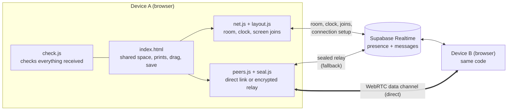
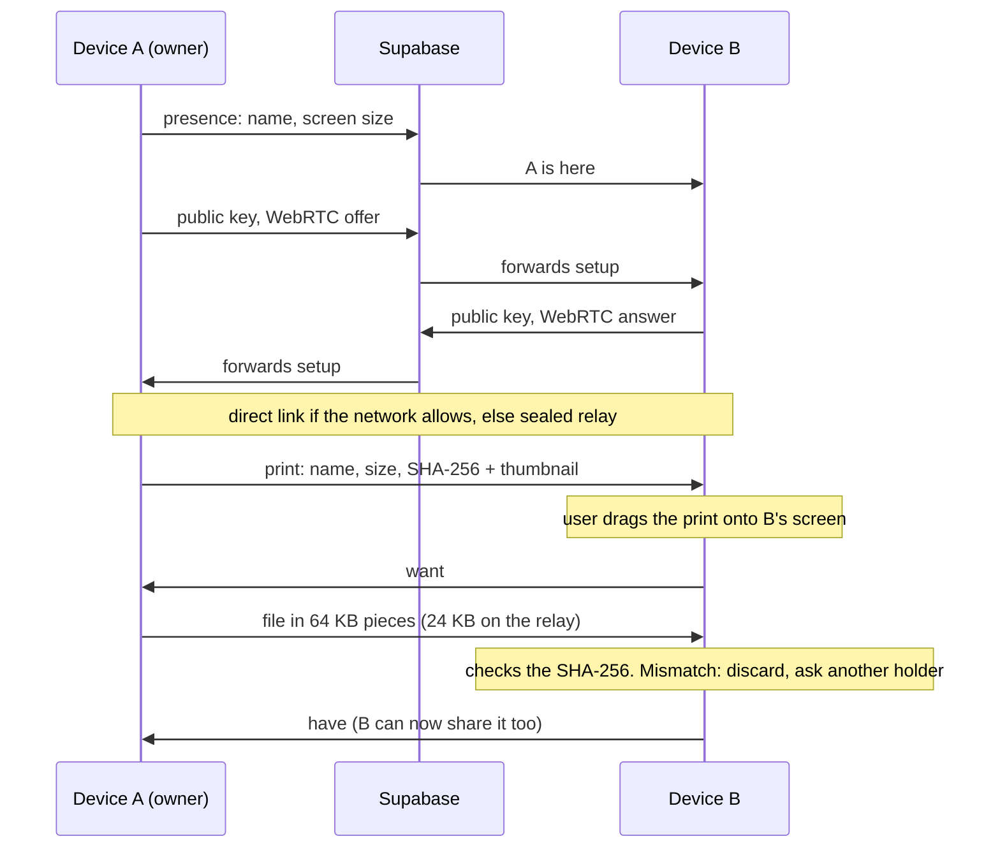
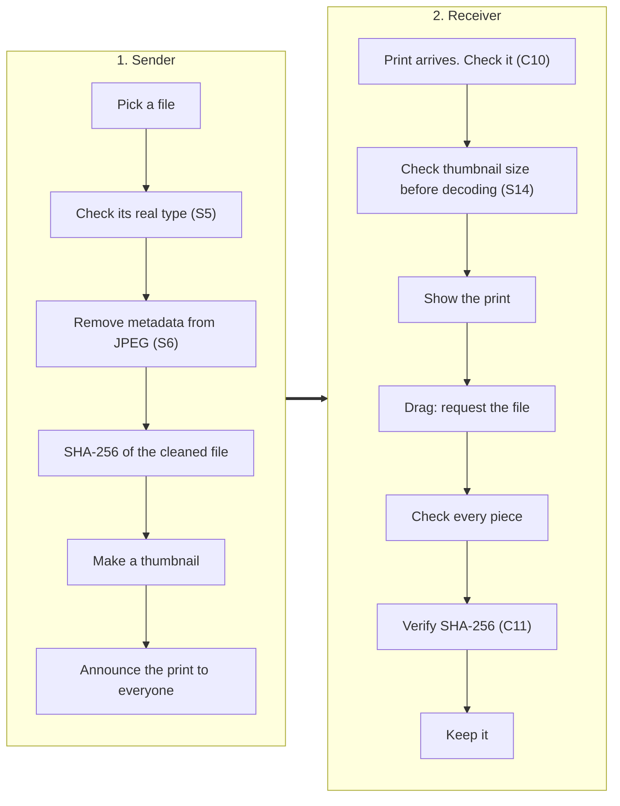

# Architecture: universal sharing

How the product is built. What it must do is in the [PRD](PRD.md). How it is attacked is in the [threat model](THREAT-MODEL.md). How it is tested is in [TESTING.md](TESTING.md). The engineering rules every change follows are in [AGENTS.md](../AGENTS.md).

## 1. Overview
The product is a static website hosted on GitHub Pages, with no server code of its own. Supabase Realtime is the only server: it tracks who is in each room and passes messages between devices. Content travels directly between devices where the network allows it.

## 2. Components
| Component | File | Responsibility |
|---|---|---|
| Shared space | `web/index.html` | Prints, dragging, saving, requesting and receiving files |
| Room | `web/net.js` | Presence, the shared clock, orb pushes and screen joins |
| Layout | `web/layout.js` | Where each screen sits in the shared space |
| Links | `web/peers.js` | Direct WebRTC links. The encrypted relay when those fail |
| Encryption | `web/seal.js` | ECDH P-256 key exchange, HKDF, AES-256-GCM |
| Validation | `web/check.js` | A check for every message type, piece lengths and SHA-256 |

## 3. Message flow

## 4. The time keeper
One device keeps the shared clock and pairs orb pushes into screen joins. Other devices sync their clocks to it and accept layouts only from it.

| | |
|---|---|
| **Today** | The device with the earliest join time. Each device reports its own join time. A device can claim to be first (S1.1, threat T-S2) |
| **Planned** | The host (the device that created the room) is the time keeper. The room link carries the host's key fingerprint after the `#`, which browsers never send to the server. Joiners accept clock replies and layouts only from the device holding that key (S1.1, S1.4, S2). The host's key is kept between reloads (see Keys). The fingerprint in shared links then keeps matching for the room's lifetime |
| **Open** | Who takes over when the host leaves (OQ8) |

## 5. Messages
Every message from another device is checked in `web/check.js` (or `net.js` for pushes) before use. Anything without a check is dropped. This table is the list to update when a message type is added.

**Room messages** (through Supabase)
| Message | Carries | Accepted from | Check |
|---|---|---|---|
| presence | name, screen size, join time | Any device | `validPeerMeta` |
| `ping` | clock request | Any device | `validPing`. Only the time keeper answers |
| `pong` | clock reply | Should be the time keeper only (S1.4) | `validPong` |
| `push` | an orb push: edge, position, time | Devices in the room | `validPush` in `net.js` |
| `layout` | how screens are joined | The time keeper only | `isValidJoins` and the sender is the time keeper |
| `joined` · `retry` · `nomatch` | join results | Should be the time keeper only | `isValidJoins` · `validDevList` · `validDev` |
| `sig` | connection setup: public key, WebRTC offer or answer, network candidate or a sealed relay frame | Any device. The sender isn't proven yet (S2) | `validSignal`: exactly one kind per message |

**Device messages** (direct link or sealed relay)
| Message | Carries | Accepted from | Check |
|---|---|---|---|
| `print` | a shared item's name, type, size, SHA-256, place | Any device | `validPrint` |
| `move` | a print's new place | Any device | `validMove` |
| `want` | a request for a file | Any device. Planned: only devices it was shared with (S10) | `validPidMsg` |
| `have` | "I now hold this file" | Any device | `validPidMsg` |
| `need` | a request for missing pieces | Any device | `validNeed` |
| `chunk` | one piece of a file | Only the device the file was requested from | `validChunk`: expected transfer, size, index and exact length |
| `dropcheck` | "check whether this print landed on you" | Any device | `validPidMsg` |

## 6. Keys
| | |
|---|---|
| **Made** | A new ECDH P-256 key pair when the page opens. The private key can't be exported |
| **Shared** | The public key is sent in a `sig` message to each device. A device that receives a first key answers with its own |
| **Used for** | Each pair of devices derives one AES-256-GCM key with HKDF-SHA256 (salt: `'phototable:'` + the room code, a leftover from the project's old name; info: both device ids, sorted). Every relayed frame gets a fresh random IV and is bound to sender and receiver as associated data |
| **Lives** | In memory for as long as the page is open. Never stored. Reloading makes new keys. Planned: the host's key pair is stored in IndexedDB as a non-exportable key until the room expires (S11). A reload then keeps the same fingerprint. Other devices still make new keys on reload |
| **Accepted** | The first key from each device. Later keys are ignored. Verifying keys with four words is planned (S3) |

## 7. File checks on send and receive
Where each check sits. Planned steps are marked with their requirement.

Metadata must be removed before the SHA-256 is taken. Otherwise the receiver's fingerprint check fails.

## 8. Engineering rules
The five rules in [AGENTS.md](../AGENTS.md) shape the design:
1. **Stranger:** every message from another device is checked or dropped.
2. **Deaf Relay:** the room server only ever sees sealed bytes.
3. **One Slow Phone:** no device can hold up anyone else.
4. **Fingerprint:** a file is kept only if it matches its fingerprint.
5. **Two-Browser:** joining and transfer changes pass the two-browser test before merging.

## 9. Dependencies
| Dependency | Used for | Notes |
|---|---|---|
| Supabase Realtime | Presence and messages | Free tier. See technical risks |
| GitHub Pages | Hosting | Static files only |
| Google STUN server | Finding a direct route between devices | No TURN server: blocked networks use the relay |
| supabase-js, hash-wasm, exifr | Client libraries | MIT licensed, vendored in `web/vendor/` |

## 10. Constraints
- **No server code.** GitHub Pages serves static files only. It cannot send security headers. Protections that need headers use workarounds in the page (S12, S15).
- **No TURN server.** When a direct link is blocked, files use the encrypted relay instead.
- **Supabase free tier.** Message rate and project activity limits apply (see technical risks).

## 11. Deploy
A GitHub Actions workflow (`.github/workflows/pages.yml`) publishes the `web/` folder to GitHub Pages on every push to `main`. There is no build step: the files are served as they are.

## 12. Technical risks
| Risk | Likelihood | Impact | Mitigation |
|---|:---:|:---:|---|
| iPhones may run out of memory on large files. A file is held in memory while it arrives | Medium | Medium | A lower limit on phones. Or write pieces to storage as they arrive |
| The relay is limited to a few messages a second on the free tier. Large relayed files are slow | High | Low | Prefer direct links. Show progress (F2) |
| iOS pauses the page when the screen locks, interrupting transfers | High | Medium | Missing pieces are requested again on wake. Warn before locking |
| Some networks block WebRTC (hotels, mobile data) | High | Low | The encrypted relay covers this, more slowly |
| The host's page reloads or is closed before its key is stored (planned design). Shared links stop matching the time keeper | Medium | High | Store the host key in IndexedDB (Keys). If it is lost anyway, the host makes a new link and the old one stops working |
| Removing metadata from HEIC and video in the browser is much harder than JPEG. The vendored exifr library can read metadata but not remove it | High | Medium | S6 covers JPEG first. S17 covers the other formats later. Check whether the iPhone file picker already converts HEIC to JPEG |
