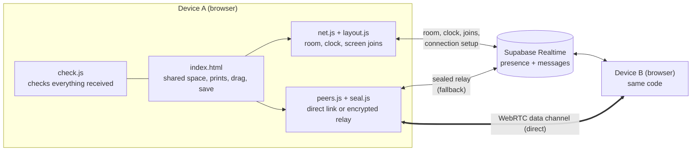
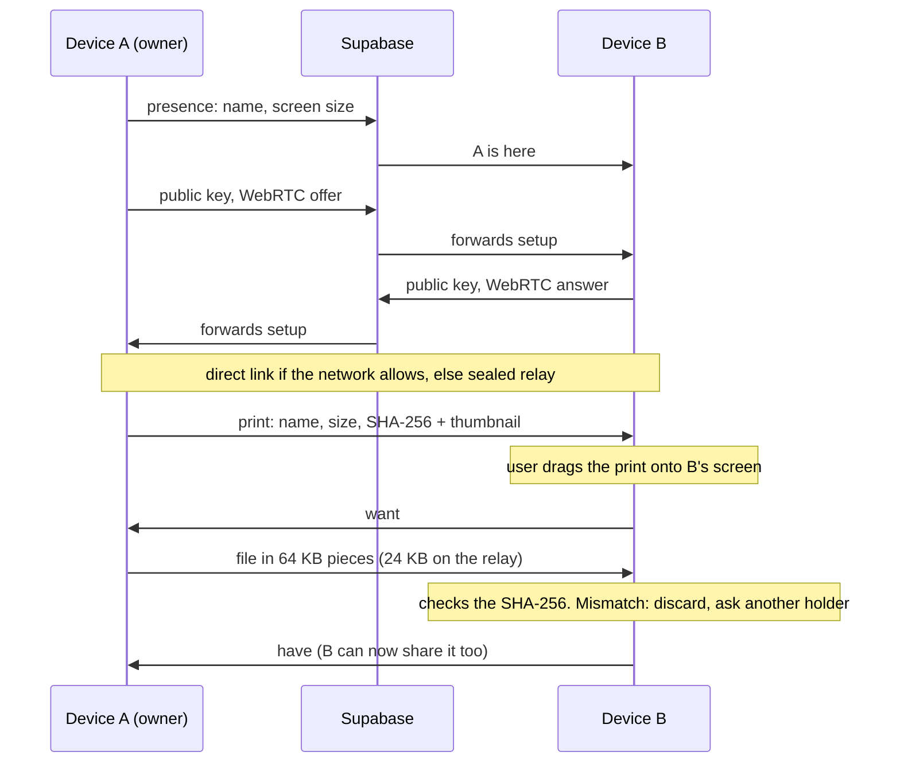
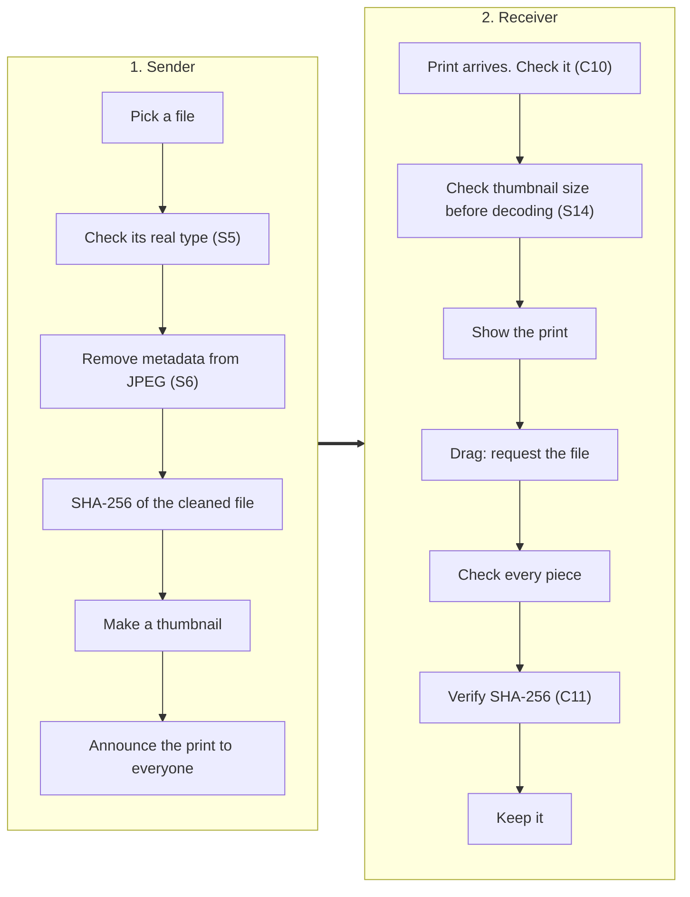
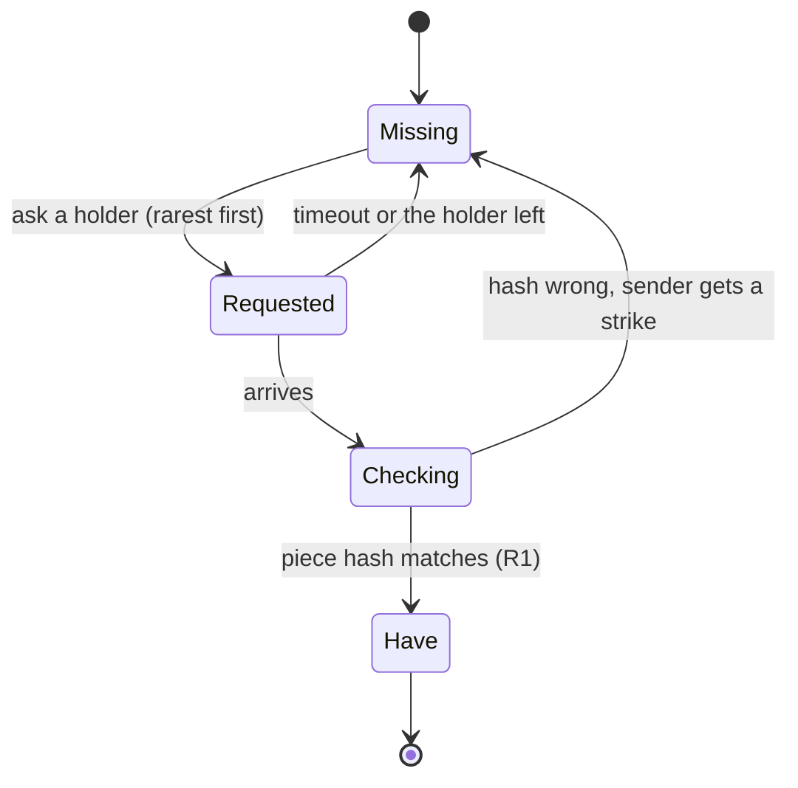

# Architecture: universal sharing

How the product is built. What it must do is in the [PRD](PRD.md). How it is attacked is in the [threat model](THREAT-MODEL.md). How it is tested is in [TESTING.md](TESTING.md). The engineering rules every change follows are in [AGENTS.md](../AGENTS.md).

## 1. Overview
The product is a static website hosted on GitHub Pages, with no server code of its own. Supabase Realtime is the only server: it tracks who is in each room and passes messages between devices. Content travels directly between devices where the network allows it.



## 2. Components
| Component | File | Responsibility |
|---|---|---|
| Shared space | `web/index.html` | Prints, dragging, saving, requesting and receiving files |
| Room | `web/net.js` | Presence, the shared clock, screen joins (orb pushes today, join tabs and the mini-map planned: C15, C16) and unique names (planned: S19) |
| Layout | `web/layout.js` | Where each screen sits in the shared space |
| Links | `web/peers.js` | Direct WebRTC links. The encrypted relay when those fail |
| Encryption | `web/seal.js` | ECDH P-256 key exchange, HKDF, AES-256-GCM |
| Validation | `web/check.js` | A check for every message type, piece lengths and SHA-256 |

## 3. Message flow


## 4. The time keeper
One device keeps the shared clock and pairs join taps into screen joins (orb pushes until C15 ships). Other devices sync their clocks to it and accept layouts only from it. Planned: it also keeps names unique in the room (S19) and passes on mini-map requests (C16).

| | |
|---|---|
| **Today** | The device with the earliest join time. Each device reports its own join time. A device can claim to be first (S1.1, threat T-S2) |
| **Planned** | The host (the device that created the room) is the time keeper. The room link carries the host's key fingerprint after the `#`, which browsers never send to the server. Joiners accept clock replies and layouts only from the device holding that key (S1.1, S1.4, S2). The host's key is kept between reloads (see Keys). The fingerprint in shared links then keeps matching for the room's lifetime |
| **Open** | Who takes over when the host leaves (OQ8) |

## 5. Messages
Every message from another device is checked in `web/check.js` (or `net.js` for pushes) before use. Anything without a check is dropped. This table is the list to update when a message type is added.

**Room messages** (through Supabase)
| Message | Carries | Accepted from | Check |
|---|---|---|---|
| presence | name, screen size, join time. Planned: signing public key (S2) | Any device | `validPeerMeta`. Planned: `validName` (S19) |
| `ping` | clock request | Any device | `validPing`. Only the time keeper answers |
| `pong` | clock reply | Should be the time keeper only (S1.4) | `validPong` |
| `push` | an orb push: edge, position, time. Planned: replaced by a join tap (edge, time) when C15 ships | Devices in the room | `validPush` in `net.js` |
| `arrange` (planned, C16) | a mini-map request: "put me below Sam" | Devices in the room. Only the device named can accept | `validArrange` (to write) |
| `arrange-ok` · `arrange-no` (planned, C16) | the answer to a mini-map request | Only the device that was asked | `validArrangeReply` (to write) |
| `layout` | how screens are joined | The time keeper only | `isValidJoins` and the sender is the time keeper |
| `joined` · `retry` · `nomatch` | join results | Should be the time keeper only | `isValidJoins` · `validDevList` · `validDev` |
| `sig` | connection setup: public key, WebRTC offer or answer, network candidate or a sealed relay frame | Any device. The sender isn't proven yet (S2) | `validSignal`: exactly one kind per message |

**Device messages** (direct link or sealed relay)
| Message | Carries | Accepted from | Check |
|---|---|---|---|
| `print` | a shared item's name, type, size, SHA-256, place. Planned: whether it is for the joined group or everyone (F11, F12), a signature (S2) and, later, piece hashes (R1) | Any device | `validPrint` |
| `move` | a print's new place | Any device | `validMove` |
| `want` | a request for a file | Any device. Planned: only devices it was shared with (S10) | `validPidMsg` |
| `have` | "I now hold this file" | Any device | `validPidMsg` |
| `need` | a request for missing pieces | Any device | `validNeed` |
| `chunk` | one piece of a file | Only the device the file was requested from | `validChunk`: expected transfer, size, index and exact length. A finished thumbnail is decoded only if `thumbFits` accepts it: one JPEG frame of at most 400 × 400 with nothing after its end marker (S14) |
| `dropcheck` | "check whether this print landed on you" | Any device | `validPidMsg` |
| `got` (planned, F14) | "this file arrived and passed its fingerprint" | Devices it was sent to | `validPidMsg` |

## 6. Keys
| | |
|---|---|
| **Made** | A new ECDH P-256 key pair when the page opens. The private key can't be exported |
| **Shared** | The public key is sent in a `sig` message to each device. A device that receives a first key answers with its own |
| **Used for** | Each pair of devices derives one AES-256-GCM key with HKDF-SHA256 (salt: `'phototable:'` + the room code, a leftover from the project's old name; info: both device ids, sorted). Every relayed frame gets a fresh random IV and is bound to sender and receiver as associated data |
| **Lives** | In memory for as long as the page is open. Never stored. Reloading makes new keys. Planned: the host's key pair is stored in IndexedDB as a non-exportable key until the room expires (S11). A reload then keeps the same fingerprint. Other devices still make new keys on reload |
| **Accepted** | The first key from each device. Later keys are ignored. Verifying keys with four words is planned (S3), as an optional "Check this device" step |
| **Tied to the id (planned, S2, #24)** | A device's id is the first 128 bits of the SHA-256 of its two public keys (encryption then signing, each in raw form), in base64url. Both keys are announced together. Keys that don't hash to their id are dropped, so nobody can claim another device's id or attach their own signing key to it. No signed message is accepted until its sender's keys have been checked against its id |
| **Signing (planned, S2)** | A second key pair, ECDSA P-256, made at the same time and also non-exportable. Its public key is announced in presence. Room messages (which every device sees, so no pair key covers them) and anything passed on for someone else (piece hashes, R1) are signed with it. Every device checks the signature and drops anything that doesn't match |

### 6.1 Identity (planned: S2, S18, S19, S20)
There are no accounts. A device is known by what it holds, not by who the person is.

| Part | Where it comes from | How long it lasts |
|---|---|---|
| Device id | Today random. Planned: the hash of both public keys (S2, #24), so it lasts as long as the keys | The tab's lifetime (S18) |
| Name | Typed by the person. Checked by `validName`, compared by its name key (S19) | The tab's lifetime |
| Encryption and signing keys | Made in the browser. The private keys can't be exported | The tab's lifetime. Longer only if the person turns on "Remember this device" (S20) |
| Colour and icon | Picked from the signing key's SHA-256: about 12 colours × 16 icons | As long as the key |

**Surviving a reload (S18).** `sessionStorage` holds a random tab id, which survives a reload and is cleared when the tab closes. Keys can't go in `sessionStorage` (it only stores text), so they are kept in IndexedDB as non-exportable `CryptoKey` objects under that tab id. On load, a device that finds its tab id reuses its id, name and keys. Entries for tabs that no longer exist are deleted after a day. "Duplicate tab" copies `sessionStorage`: if the room already has a device with this id, the newer tab makes a new tab id and starts fresh.

**Names (S19).** The name key, used only for comparing:
```js
const nameKey = (s) => s.normalize('NFKC').normalize('NFD').replace(/\p{M}/gu, '')
  .toUpperCase().toLowerCase().trim().replace(/\s+/g, ' ');
```
`toUpperCase().toLowerCase()` also folds `ß` to `ss`. `toLocaleLowerCase()` isn't used, because Turkish `İ` and `ı` change with the locale. `validName` refuses control and format characters (`\p{C}`: zero-width spaces, joiners, text-direction overrides), names that mix scripts (Latin with Cyrillic, for example) and names longer than 24 characters as seen on screen (counted with `Intl.Segmenter`). Look-alikes inside one script ("5am", "rn" for "m") can't all be caught. The colour and icon are the backstop.

**Remembered devices (S20).** Off by default. When turned on, the device's signing key is kept in IndexedDB until "Forget". Other devices keep the public keys of devices they've seen, with the name each used, also in IndexedDB. A device whose key is known shows "seen before". A known name on a key that isn't known shows "new device". Nothing about this is sent to the server.

## 7. File checks on send and receive
Where each check sits. Planned steps are marked with their requirement.


Metadata must be removed before the SHA-256 is taken. Otherwise the receiver's fingerprint check fails.

## 8. Engineering rules
The rules in [AGENTS.md](../AGENTS.md) shape the design:
1. **Stranger:** every message from another device is checked or dropped.
2. **Deaf Relay:** the room server only ever sees sealed bytes.
3. **One Slow Phone:** no device can hold up anyone else.
4. **Fingerprint:** a file is kept only if it matches its fingerprint.
5. **Two-Browser:** joining and transfer changes pass the two-browser test before merging.
6. **Allowlist:** metadata leaves the device only as fields we have named and chosen to keep.

## 9. Dependencies
| Dependency | Used for | Notes |
|---|---|---|
| Supabase Realtime | Presence and messages | Free tier. See technical risks |
| GitHub Pages | Hosting | Static files only |
| Google STUN server | Finding a direct route between devices | No TURN server: blocked networks use the relay |
| supabase-js, hash-wasm, exifr | Client libraries | MIT licensed, vendored in `web/vendor/` |

## 10. Constraints
- **No server code.** GitHub Pages serves static files only. It cannot send security headers. Protections that need headers use workarounds in the page (S12, S15).
- **No TURN server.** When a direct link is blocked, files use the encrypted relay instead.
- **Supabase free tier.** Message rate and project activity limits apply (see technical risks).

## 11. Deploy
A GitHub Actions workflow (`.github/workflows/pages.yml`) publishes the `web/` folder to GitHub Pages on every push to `main`. There is no build step: the files are served as they are.

## 12. Technical risks
| Risk | Likelihood | Impact | Mitigation |
|---|:---:|:---:|---|
| iPhones may run out of memory on large files. A file is held in memory while it arrives | Medium | Medium | A lower limit on phones. Or write pieces to storage as they arrive |
| The relay is limited to a few messages a second on the free tier. Large relayed files are slow | High | Low | Prefer direct links. Show progress (F2) |
| iOS pauses the page when the screen locks, interrupting transfers | High | Medium | Missing pieces are requested again on wake. Warn before locking |
| Some networks block WebRTC (hotels, mobile data) | High | Low | The encrypted relay covers this, more slowly |
| The host's page reloads or is closed before its key is stored (planned design). Shared links stop matching the time keeper | Medium | High | Store the host key in IndexedDB (Keys). If it is lost anyway, the host makes a new link and the old one stops working |
| A private browsing window or a browser clearing storage loses the tab's IndexedDB keys. A reload then looks like a new device (S18) and "Remember this device" can't work (S20) | Medium | Low | Treat it as a new device. Say so in settings when storage isn't available |
| Auto-fetching joined prints (F11) and sharing with everyone (F12) send far more data than dragging one print. The relay is slow and rate-limited | High | Medium | The 20 MB limit (OQ9). Prefer direct links. Later, pieces spread between devices instead of all coming from the sender (R2, R3) |
| Removing metadata from HEIC and video in the browser is much harder than JPEG. The vendored exifr library can read metadata but not remove it | High | Medium | S6 covers JPEG first (`web/strip.js`, which copies the image segments it keeps and drops the rest). Every other file (HEIC, PNG, WebP, video) is sent with a "details not removed" warning. S17 covers the other formats later. Check whether the iPhone file picker already converts HEIC to JPEG |

## 13. Later: spreading pieces through the room (R1–R5)
Not built. Today a file comes from one holder at a time and every pair of devices can link directly. This is the design the later requirements point at, so changes before then don't block it.

**Two networks, as now.** The room server is a star: presence, the clock, joins and introductions. The devices form a mesh for content. A private send ("Send to…") always uses one direct link between the two devices or the sealed relay. It never travels through a third device. Only shared-with-everyone and joined-group files spread.

**Where data gets lost today and what handles it**
| Layer | Loses data? | Handled by |
|---|---|---|
| One WebRTC link | Packets drop. Data channels are reliable and ordered: SCTP resends only the missing parts (selective acknowledgements) | The browser |
| The relay | Yes. Supabase broadcasts have no acknowledgement and can be dropped under load | `need`: the receiver lists the missing pieces every 1.5 s and only those are sent again |
| A holder going away | Yes: a phone locks, leaves or goes slow | Today: the transfer asks the same device again and gives up after a minute (C12). Later: R2 |

**Gaps in today's code that R2 closes:** `need` always goes to the device the transfer started with, even when other holders are listed. Pieces are only accepted from that one device. A change of piece size (direct to relay) throws away the pieces already received. A bad piece is only found by the whole-file SHA-256 at the end, so the whole file is fetched again and the sender can't be told apart. "I have it" claims aren't checked. The whole file is held in memory.

**Each piece has a state**


**How it spreads (R3).** Each device links to a few neighbours (about 4–6: its joined screens plus a few others), so links grow with the number of devices instead of its square. Devices tell their neighbours which pieces they hold. Rarest pieces are asked for first. Each device serves only a few others at once. The sender hands different pieces to different neighbours first. Near the end, the last pieces are asked from several holders and the first to arrive wins, so one slow phone can't hold up the finish (Rule 3). Requests in flight are capped per neighbour and every request has a timeout.

**Repair pieces (R5).** Only if R4 shows the relay losing a lot. Reed–Solomon adds a fixed number of repair pieces. Fountain codes (RaptorQ, for example) can make any number, so different devices can send different repair pieces without coordinating. Either costs encoding work on phones.

**Why not a library.** WebTorrent does this in the browser over WebRTC. It brings its own wire protocol and public trackers, which don't fit the Deaf Relay rule. It is also a large dependency to review. A small version built on the existing messages and checks fits better.
