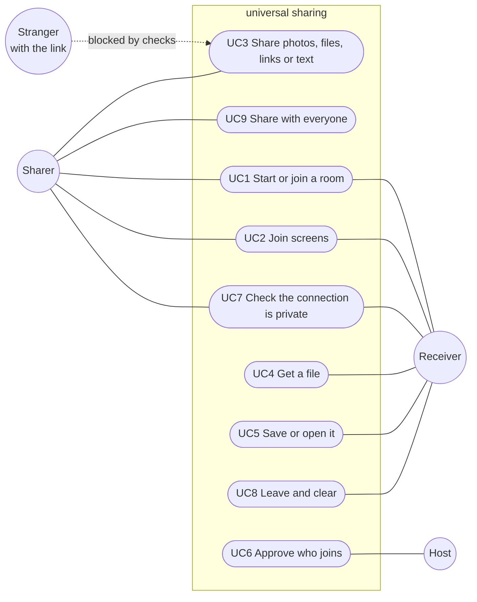

# Product Requirements Document: universal sharing

What the product should do and why. Related documents: [Architecture](ARCHITECTURE.md) (how it's built) · [Threat model](THREAT-MODEL.md) (how it's attacked) · [Testing](TESTING.md) (how it's proven) · [AGENTS.md](../AGENTS.md) (engineering rules). Progress is tracked on the [project board](https://github.com/users/jtbinith/projects/7).

## Contents
1. [Overview](#1-overview)
2. [Users](#2-users)
3. [Goals](#3-goals)
4. [Scope](#4-scope)
5. [Use cases](#5-use-cases)
6. [User stories](#6-user-stories)
7. [Requirements](#7-requirements)
8. [Security and privacy](#8-security-and-privacy)
9. [Success measures](#9-success-measures)
10. [Risks](#10-risks)
11. [Open questions](#11-open-questions)
12. [Assumptions](#12-assumptions)
13. [Glossary](#13-glossary)

## 1. Overview
### 1.1 Summary
universal sharing is a website for sharing photos, videos, files, links and text between phones, tablets and laptops. Each person opens the room link and joins their screen to the others to make one shared space. Photos dropped into a joined space arrive on everyone's screen without dragging. "Share with everyone" reaches the whole room. Dragging a print across is still there for passing one photo to one screen. Files arrive at full quality. There is no app to install and no account to create.

It is designed for people in the same place. It does not prevent remote joining: anyone with the room link can join from anywhere unless the host approves each device (S4).

### 1.2 Problem
Sharing between different kinds of devices is still awkward:
- Built-in sharing only works between devices of the same brand.
- Messaging apps compress photos. Cloud albums need everyone to have an account on the same service.
- Cables and emailing yourself are slow and fill inboxes and phone storage.
- Even a single link or address means messaging yourself to move it from a laptop to a phone.

## 2. Users
| Persona | Situation | Need |
|---|---|---|
| **Mixed-device person** | Their phone and laptop are different brands. They are on their own | Join their own two devices alone (F10). Move photos, files, links and text between them in seconds |
| **A group after a trip or event** | Everyone has different phones and wants each other's photos | Pick the photos they want without a group chat or shared album |
| **A family at home** | Phones, tablets and a laptop in one room | Share without installing or setting anything up |

## 3. Goals
| ID | Goal |
|---|---|
| G1 | Sharing is fast. A first-time user gets one photo across in under 60 seconds with no help. The system part is quick: a device is ready to join within 5 seconds of opening the link. A 5 MB photo arrives in under 3 seconds directly or under 15 seconds through the relay |
| G2 | Every file arrives as the original, verified by its fingerprint. The one exception is metadata, which is removed unless the sender keeps it (S6) |
| G3 | Works in current Safari, Chrome and Firefox on iOS, Android, macOS, Windows and Linux |
| G4 | Nobody in the middle can see what is shared, including the room server. This depends on S2 and S3 preventing key swaps |
| G5 | One bad, slow or hostile device cannot break the room for anyone else |

## 4. Scope
### 4.1 In scope
Photos, videos, any other file, website links and short text, shared between devices that have joined the same room.

### 4.2 Out of scope (Won't have)
- Accounts or sign-in.
- Cloud storage, history or backup. Nothing is kept after the room closes. Supabase passes messages along and stores no content.
- Chat.
- Native apps.

## 5. Use cases

The Host is whoever created the room. Anyone can be a Sharer and a Receiver at the same time. Misuse cases are in the [threat model](THREAT-MODEL.md#misuse-cases).

### 5.1 UC2 Join screens
| | |
|---|---|
| **Actors** | Two people in the same room. Or one person with two devices |
| **Precondition** | Both devices have the room open |
| **Main flow** | 1. Each person taps the join tab on the edge of their screen that faces the other device (C15). 2. Both tap within 2 seconds of each other. 3. The time keeper pairs the two taps on facing edges. 4. Both screens show "Joined with Sam's phone, on your right" with Undo. The two screens now behave as one space. |
| **Alternative flows** | 1a. Using the mini-map instead (C16): a person opens Arrange, moves their own tile next to another device's tile and taps Done. The other device sees "Ali wants to join below you" with Accept and No. The screens join only after Accept. 1b. One person with two devices: they scan the QR code shown on one screen with the other. Or they tap both screens within 3 seconds (F10). 2a. Only one person taps: after 2 seconds they are told there was no match. 3a. Three taps arrive at once and cannot be paired: everyone is asked to try again. 4a. The join is wrong or unwanted: either person taps Undo or moves their tile in the mini-map. |
| **Postcondition** | Prints can be dragged across the shared edge. Prints dropped into the shared space arrive on every joined screen (F11) |

### 5.2 UC4 Get a file
| | |
|---|---|
| **Actors** | Receiver and the device holding the file |
| **Precondition** | Screens are joined and the file's print is visible |
| **Main flow** | 1. The receiver drags the print onto their screen. 2. Their device requests the file from the holder. 3. Pieces arrive directly or through the encrypted relay. 4. The file is checked against its SHA-256. 5. "Got it. Tap to save" appears. |
| **Alternative flows** | 1a. The owner has left: any device that still holds the file sends it. 1b. The print was dropped into a joined space or shared with everyone: the request starts by itself, with no drag (F11, F12). 1c. Using "Send to…" or the keyboard instead of dragging (N4). 3a. Pieces go missing: only those pieces are requested again. 3b. Nothing arrives for a minute: "It didn't arrive. Drag it again". Later: another holder is asked first (R2). 4a. The fingerprint does not match: the copy is discarded and requested from another holder. |
| **Postcondition** | The receiver holds the original file and can share it on |

### 5.3 Other use cases
| Use case | Actor | Summary |
|---|---|---|
| UC1 Start or join a room | Anyone | "New room" creates a 10-letter code. Others open the link or type the code. Each person types a name, which must be unique in the room (S19) |
| UC3 Share photos, files, links or text | Sharer | Pick photos, videos or files. Or paste a link or text. A print appears for everyone: a thumbnail for photos and a card for everything else. Nothing downloads until someone asks for it, except on joined screens (F11) |
| UC5 Save or open it | Receiver | Tap a received print. Phones open the share sheet and laptops download the file. A link shows its full address before it opens. "Save all" saves every received photo in one go (F13) |
| UC6 Approve who joins | Host | A new device waits until the host accepts it (S4) |
| UC7 Check the connection is private | Sharer and Receiver | Optional. Tap a device's name, then "Check this device": both screens show the same four words. A mismatch warns both people (S3). It is never part of a quick share |
| UC8 Leave and clear | Anyone | Leaving removes everything received from the browser's memory (S13) |
| UC9 Share with everyone | Sharer | Drop a print on the "For everyone" tray. Or tap the print and choose "Share with everyone". Every device in the room receives it, joined or not (F12) |

## 6. User stories
Priorities use MoSCoW: **M**ust, **S**hould, **C**ould.

| ID | Story | Pri | Req |
|---|---|:---:|---|
| US1 | As a mixed-device person, I want to drag a photo from my phone to my laptop so that I stop emailing photos to myself | M | C6 |
| US2 | As someone after a trip, I want to drag 20 photos across at once so that sharing a whole day is quick | M | F1 |
| US3 | As a receiver, I want to see progress and a clear message when something fails so that I know whether to wait or retry | M | F2 |
| US4 | As an iPhone user, I want received photos to save to my camera roll so that they sit with the rest of my photos | M | F3 |
| US5 | As a sharer, I want my photos sent without location or device details so that strangers in the room can't learn where I live | M | S6 |
| US6 | As a host, I want to approve each device that joins so that a stranger with the link can't get in | S | S4 |
| US7 | As anyone in a room, I want to compare a short code with the other person so that I know nobody is intercepting us | M | S3 |
| US8 | As a receiver, I want photos I already have to be marked so that I don't download duplicates | S | F4 |
| US9 | As a group of three, I want all our screens joined into one space so that photos can cross between any of us | S | F5 |
| US10 | As someone reading on my laptop, I want to send the page's link to my phone so that I can carry on there | S | F7 |
| US11 | As a student, I want to send a PDF from my laptop to my phone so that I have my notes on the go | S | F8 |
| US12 | As a receiver, I want to see what a file really is before I open it so that a stranger can't pass off something harmful as a photo | S | S5 |
| US13 | As someone filling in a form on my phone, I want to send an address or code from my laptop so that I can paste it straight in | S | F9 |
| US14 | As anyone in a room, I want strangers' images hidden until I choose to see them so that nobody can push unwanted pictures onto my screen | S | S9 |
| US15 | As a sharer, I want only the people I share with to be able to download my files so that others in the room can't take them | S | S10 |
| US16 | As someone on my own with a phone and a laptop, I want to join my two screens by myself so that I don't need a second person | M | F10 |
| US17 | As someone who can't drag easily or uses a screen reader, I want to send a file with a button so that I can share without dragging | S | N4 |
| US18 | As a group with joined screens, I want photos dropped into our space to arrive on all our devices so that nobody has to drag each one | S | F11 |
| US19 | As a sharer, I want to share a photo with everyone in the room at once so that the whole table gets it in one step | S | F12 |
| US20 | As a receiver, I want to save every photo I've received in one tap so that I don't save them one by one | S | F13 |
| US21 | As anyone in a room, I want to see whether a device is one I've seen before so that I notice when someone new uses a friend's name | C | S20 |
| US22 | As anyone joining, I want to be told if my name is already taken so that nobody mixes me up with someone else | S | S19 |
| US23 | As someone whose page reloads, I want to come back as the same device so that my joins carry on and transfers restart by themselves | S | S18 |
| US24 | As anyone dragging, I want a print never to get stuck at the edge of a screen so that I can always pick it up again | S | F16 |
| US25 | As a laptop user, I want to pick a print up with one click and drop it with another so that I don't have to hold the trackpad down | S | F17 |

### 6.1 Acceptance criteria
| Story | Given | When | Then |
|---|---|---|---|
| US1 | Two joined devices and a photo on one | The photo's print is dragged onto the other screen | The original file arrives and can be saved |
| US2 | 20 prints on a joined screen | The receiver selects them all and drags them across | All 20 arrive and pass their fingerprint check |
| US3 | A transfer in progress | The receiver looks at its print | It shows "40% · 2.1 of 5.3 MB" |
| US3 | A copy that fails its fingerprint check | The check runs | The message reads "That copy of beach.jpg was damaged. Getting it from Mango instead" |
| US5 | A JPEG photo containing GPS and camera details | It is shared | The received file contains neither |
| US5 | The sharer ticks "Keep details" | It is shared | The original is sent unchanged |
| US6 | A room I created | A new device opens the link | It sees "Waiting for the host" until I tap Accept. If I tap Decline, it receives nothing |
| US7 | Two linked devices | Both open "Check this device" for the other | Both show the same four words |
| US7 | A server that swapped a key | Both open "Check this device" for the other | The words differ and both screens warn "This connection may not be private" |
| US10 | Two joined devices | I paste a link | A link card showing its website appears for everyone. Tapping it shows the full address before opening. Only http and https are allowed |
| US13 | Two joined devices | I paste text | A text card appears. Tapping it copies the text. Nothing is copied automatically |
| US14 | A device I haven't approved shares an image | Its print appears | Its thumbnail is blurred until I tap it. I can block that device |
| US15 | A file shared with one person | Another device in the room requests it | The request is refused |
| US16 | A phone and a laptop with the room open, one person | They scan the laptop's QR code with the phone | The two screens join without anyone else |
| US17 | A received print | The user presses "Send to…" and picks a device, using only a keyboard or screen reader | The file is sent. Every print, button and join tab has a spoken label |
| US18 | Three joined screens | Sam drops a photo into the shared space | Both other devices fetch it without anyone dragging. Each shows "1 new photo from Sam" |
| US18 | Two screens joined with join tabs 3 seconds ago | Sam drops a photo | Nothing is fetched by itself until the 10-second Undo window has passed. Undo in that time means nothing was ever fetched |
| US18 | A joined screen and a 30 MB video | It is dropped into the shared space | It isn't fetched by itself. Its card says "30 MB. Tap to get it" |
| US19 | Five devices in a room, two of them joined | Sam drops a photo on the "For everyone" tray | All four other devices receive it. Sam's print shows "Received by 4 of 4" |
| US20 | 12 received photos on a phone | The receiver taps "Save all" | The share sheet opens once with all 12 files |
| US21 | A device that turned on "Remember this device" and was seen yesterday | It joins today with the same name | It shows "seen before" |
| US21 | A remembered name | A different device joins with that name in another room | It shows "new device" |
| US22 | Someone called "Sam" in the room | A new device types "sam", "SAM" or "Ｓａｍ" | It sees "Someone in this room is already called Sam" and can't join until the name is different. No name is suggested |
| US23 | A device joined to another screen and halfway through a transfer | Its page reloads | It comes back with the same id, name and colour, still joined. The transfer starts again by itself and finishes. Nothing it had received was written to disk |
| US24 | A print being dragged | The phone takes over the gesture (the drag is cancelled) | The print goes back to where the drag started |
| US25 | A laptop with a print on screen | The user clicks the print, moves the pointer and clicks again | The print moves without the button being held. Esc puts it back |

## 7. Requirements
Every feature of the product is listed here. IDs are permanent: a dropped requirement is marked "Withdrawn", never renumbered.

**Scope note.** This is more than three part-time weeks can deliver. Must requirements come first. Should and Could requirements are expected to slip and move to a later version if time runs out. The order of work is on the [project board](https://github.com/users/jtbinith/projects/7), sorted by priority.

### 7.1 Core sharing
| ID | Requirement | Pri | Acceptance |
|---|---|:---:|---|
| C1 | Rooms are identified by a 10-letter code from a 32-character alphabet | M | Codes are random and cannot be guessed or listed. Hand-typed short codes are refused |
| C2 | **Withdrawn** (replaced by C15 and C16). Screens join by pushing orbs to a shared edge at the same moment | — | Dragging an orb to the edge clashes with the phone's own edge gestures and is awkward on a trackpad |
| C3 | A shared clock lets join taps from different devices be paired | M | Taps within 2 seconds of each other pair on every device's clock |
| C4 | Several photos and videos can be picked at once and appear as prints with thumbnails for everyone | M | Picked files appear on every joined screen |
| C5 | Prints stay in place when screens join or a screen leaves | M | No print moves on screen when the layout changes |
| C6 | Dragging a print onto your screen fetches the full file | M | US1 |
| C7 | Tapping a received print saves it | M | The share sheet opens on phones. A download starts on laptops |
| C8 | Files go directly between devices over WebRTC | M | Two devices on an open network use a direct link |
| C9 | When a direct link is blocked, files go through an end-to-end encrypted relay | M | Two devices on a network that blocks WebRTC still exchange files. The server sees only ciphertext |
| C10 | Every message from another device is checked or dropped | M | The Stranger rule in AGENTS.md |
| C11 | Every file is verified against its SHA-256. A damaged copy is fetched from another holder | M | UC4 flow 4a |
| C12 | Missing pieces are requested again. The transfer gives up after a minute of silence | M | UC4 flows 3a and 3b |
| C13 | Late guests can still receive files after the owner leaves | M | UC4 flow 1a |
| C14 | Files up to 200 MB are supported | M | A 200 MB file arrives verified |
| C15 | Screens join by tapping join tabs on facing edges at the same moment | M | UC2. Each screen has a tab on every edge, inset from the bezel so it never sits where the phone's own edge gestures start. Tabs are buttons: they work with touch, mouse and keyboard and each has a spoken label ("Join on the right"). After a join both screens show who they joined and on which side, with Undo |
| C16 | A mini-map shows every device in the room as a tile. Each person moves only their own tile | M | UC2 flow 1a. A tile can be moved by dragging or with arrow keys. Placing a tile next to another device asks that device to accept. Nothing joins until it does. The mini-map is also how a wrong join is fixed |

### 7.2 More sharing
| ID | Requirement | Pri | Acceptance |
|---|---|:---:|---|
| F1 | Select several prints and drag them together | M | US2 |
| F2 | Show progress and clear errors | M | US3 |
| F3 | Save to the camera roll on iPhone and Android | M | US4. Tapping a received photo opens the share sheet with the file |
| F4 | Spot duplicates | S | A file already held is marked by its fingerprint and not downloaded again |
| F5 | Three or more screens in one space | S | Three devices join and a photo crosses all of them |
| F6 | Overlapping prints spread out | C | New prints never land fully on top of another |
| F7 | Share website links | S | US10. Links are validated like any message: http or https only, at most 2,000 characters |
| F8 | Share any file, not just photos and videos | S | A PDF and a .docx arrive verified and show as cards with their name and size |
| F9 | Share short text | S | US13. At most 5,000 characters |
| F10 | One person can join their own two devices | M | US16. Scan a QR code shown on one screen with the other. Or tap both screens within 3 seconds. The second screen joins below the first. It can be moved to another edge with the mini-map (C16) |
| F11 | Joined screens receive by themselves | S | US18. A print dropped into a joined space is fetched by every joined device without a drag. Fetching by itself only starts once a join has settled: a mini-map join is settled when it is accepted, a join-tab join when its 10-second Undo window has passed with no Undo. Only prints dropped after the join settled are fetched by themselves. Prints from before need a tap. "Received" is not "saved": photos wait in the app until saved. Only prints from devices in the same joined group are fetched this way. Files over 20 MB wait for a tap |
| F12 | Share with everyone | S | US19, UC9. A "For everyone" tray and a "Share with everyone" option on every print. Every device in the room receives it, joined or not. The same 20 MB limit as F11 applies |
| F13 | Save all | S | US20. One tap saves every received photo: phones open the share sheet once with all the files, laptops download them |
| F14 | Delivery receipts | C | The sender's print shows "Received by 4 of 5" |
| F15 | Catch-up for late arrivals | C | A device that joins late is offered the photos shared before it arrived: "Get the 8 photos shared before you joined?" |
| F16 | A print can't get stuck | S | US24. A drag cut off by the phone (`pointercancel` or lost pointer capture) returns the print to where it started. A print always keeps at least 40 px on its screen. On a shared edge, a print belongs to the screen its centre is on and snaps fully onto it, with a small buffer so it doesn't flick back and forth. If the other screen can't take it, it snaps back. A "Tidy up" button brings every print back into view |
| F17 | Easy dragging on laptops | S | US25. Click to pick up, click to drop, with no button held. Esc cancels. Arrow keys move a focused print |
| F18 | Drags stay clear of the phone's own gestures | S | Nothing that is dragged needs to start within 24 px of a screen edge. Checked on a real iPhone (Safari) and Android phone (Chrome): back swipes, pull-down panels and the home bar are never triggered by using the site |

### 7.3 Trust and safety
Each of these answers a threat in the [threat model](THREAT-MODEL.md).

| ID | Requirement | Pri | Acceptance |
|---|---|:---:|---|
| S1 | One device cannot take over or stall the room | M | S1.1–S1.6 |
| S1.1 | The time keeper cannot be chosen by a device misreporting when it joined | M | A device claiming an early join time does not become time keeper. The time keeper is still recognised after the host reloads the page |
| S1.2 | Limits on transfers and prints apply per device, not to the room as a whole | M | One device reaching its limit does not affect anyone else |
| S1.3 | Every wait on another device has a timeout | M | A device that never sends its key does not leave sends waiting indefinitely |
| S1.4 | Clock replies are only accepted from the time keeper | M | A forged clock reply does not change anyone's clock |
| S1.5 | Resend requests are rate-limited per device | M | Repeated requests do not make a device send the same file again and again |
| S1.6 | Connection setup from devices not in the room is ignored | M | Setup from an unknown device opens no connection |
| S2 | Devices cannot impersonate each other | M | A device has two key pairs: one for encryption (ECDH P-256) and one for signing (ECDSA P-256). Its id is the first 128 bits of the SHA-256 of both public keys together (extends #24). Keys that don't hash to their id are dropped, so nobody can announce their own signing key under another device's id. Messages between two devices are tied to the sender by their shared key. Room messages and anything passed on for someone else (R1) are signed and checked against the signing key bound to that id. A forged sender is dropped. Every device is shown with a colour and three emoji made from its keys, next to its name, so two devices with similar names usually look different. This is a visual aid, not a defence: someone can make keys until the look matches. The defences against look-alikes are S19, S20 and S3 |
| S3 | Both people can verify the connection is not being intercepted | M | US7. Optional: behind "Check this device" on a device's name, never in the main flow. The four words come from the SHA-256 of both public keys: 44 bits split into four 11-bit numbers, each picking a word from a 2,048-word list |
| S4 | The host approves who joins | S | US6 |
| S5 | Files are labelled by what they really are. Risky files are refused | S | US12. The type comes from the file's contents, not its name. JPEG, PNG, HEIC, WebP, GIF, MP4, MOV and PDF are recognised. Apps and scripts (.exe, .apk, .sh, .bat, .js, .html, .svg) are refused |
| S6 | Location and device details are removed from JPEG photos before sending unless the sender keeps them | M | US5. Metadata is removed first. The SHA-256 is then taken of the cleaned file. The fingerprint check (C11) still passes |
| S17 | Location and device details are removed from HEIC, PNG, WebP and video too | S | As S6, for each format. Harder in a browser than JPEG (see ARCHITECTURE.md technical risks). Checked 12 Nov on a real iPhone: the picker turns HEIC photos into JPEGs that still carry GPS, camera details and the gain map. S6 removes them from those JPEGs. Photos picked as HEIC and videos still need this |
| S7 | A room holds at most 20 devices | S | Device 21 is told the room is full. Further presences are ignored |
| S8 | Only this site can use the Supabase project | S | Realtime authorization is on: rooms are private channels that need a token from Supabase's anonymous sign-in. Users create no account. Each sign-in still makes an anonymous user record in Supabase (see OQ3). Usage is monitored in the Supabase dashboard. Whether anonymous sign-in needs a CAPTCHA is OQ7 |
| S9 | Strangers' images are hidden until tapped. Any device can be blocked | S | US14 |
| S10 | Only the people a file was shared with can download it | S | US15 |
| S11 | Rooms expire | S | A room with nobody in it for 30 minutes closes. Its code no longer works |
| S12 | Links and text from other devices are always shown as plain text. Must before F7 or F9 ships | M | A link or text containing HTML or script shows as characters and runs nothing. A content security policy blocks inline scripts |
| S13 | Leave and clear | S | "Leave" removes every received file and thumbnail from memory, deletes the tab's stored keys (S18) and closes all links. Received files are never written to disk. Keys left behind by a tab that closed without Leave are deleted at the next start-up of the site |
| S14 | Thumbnails from other devices are checked for size in pixels before they are decoded | M | A thumbnail over 400 × 400 pixels is not decoded and the print shows a plain card. Full files are never decoded on arrival. They can still be sent and saved at any size up to C14's limit |
| S15 | The site cannot be framed by another site | S | Frame-busting code stops the site running inside another site's frame. GitHub Pages cannot send a frame-blocking header. This is the workaround |
| S16 | Room links leak less | C | The room code is removed from the address bar after joining. It isn't left in browser history. An Invite button shows the full link and a QR code (including the host fingerprint) so others can still join |
| S18 | A reload is the same device coming back | S | US23. The device id, name and keys last for the tab's lifetime: they survive a reload and are gone when the tab closes. A duplicated tab makes itself a new device (it can't take the original tab's lock on its id). Received files and pieces stay in memory only, as before: after a reload, unfinished transfers start again by themselves from a holder. The stored keys are deleted when the tab closes, at the latest at the next start-up of the site (S13) |
| S19 | Names are unique in a room | S | US22. Names are compared by a name key: Unicode NFKC, accents removed from Latin, Greek and Cyrillic letters only, case folded, spaces trimmed and collapsed. A name is refused if it contains invisible or control characters (including text-direction overrides), mixes scripts in a way the Unicode standard's "Highly Restrictive" level (UTS #39) doesn't allow, or is longer than 24 characters as seen on screen. Real names that mix scripts, such as Japanese (Han, Hiragana and Katakana), are allowed. Joiners that emoji and some scripts need are allowed inside a name. A taken name shows "Someone in this room is already called Sam". Nothing is suggested: the person chooses. If two devices pick a name at the same moment, the time keeper keeps the first |
| S20 | Remembered devices (trust on first use) | C | US21. Off by default. "Remember this device so friends recognise it" keeps the device's keys in the browser and tells the room it may be remembered. Other devices store only devices that turned this on: a device that didn't is never stored by anyone. A stored device shows "seen before" when it comes back. A different device using a stored device's name shows "new device". "Forget" deletes this device's keys and every device it has stored, and tells the room to stop remembering it. Nothing is stored on the server |

### 7.4 Launch
| ID | Requirement | Pri | Acceptance |
|---|---|:---:|---|
| L1 | Choose a name | M | Not "photo table". No trademarked words |
| L2 | A first-time guide on screen | S | A new user joins screens without reading anything else |

### 7.5 Non-functional
| ID | Requirement | Pri | Acceptance |
|---|---|:---:|---|
| N1 | Performance (G1) | M | System timings are measured automatically by the two-browser test. The 60-second task is timed by hand with a first-time user on an iPhone and a laptop |
| N2 | Compatibility (G3) | M | Tested on Safari iOS, Chrome Android and Chrome and Firefox on desktop |
| N3 | Reliability: one device cannot stall the room (G5) | M | S1 and S7 met. The two-browser test sends malformed messages of every type |
| N4 | Accessibility: everything can be done without dragging | S | US17. A "Send to…" button on every print. Keyboard focus reaches every control. Screen readers announce prints, join tabs, the mini-map and messages. Motion is reduced when the device asks for it |
| Q1 | The two-browser test runs on every pull request | M | A required check in GitHub Actions blocks merging when it fails |
| Q2 | Safari is tested as well as Chrome | S | The two-browser test also runs in WebKit |
| Q3 | Review standards in Qodo do not overlap | S | The two fingerprint standards are merged into one covering "verify before keeping or announcing" |
| Q4 | Every ticket is worked the same way | M | Each PR links its ticket, lists every acceptance criterion and the edge case with results and includes the red and green test output. Tickets are worked with the `work-ticket` skill |

### 7.6 Later: reliability at scale
Not scheduled yet. Written down so the design leaves room for them. S7 caps a room at 20 devices: every device linked to every other is then 190 links, which is where these start to matter.

| ID | Requirement | Pri | Acceptance |
|---|---|:---:|---|
| R1 | Every piece has its own hash | C | A print carries a hash for each piece (or one Merkle root over them), signed by the original sender (S2). Each piece is checked as it arrives. A bad piece is dropped and its sender gets a strike, without waiting for the whole file. Needed before R2 |
| R2 | Any holder can send any piece | C | Missing pieces are asked from another holder when the first goes quiet or leaves, not just from the device the transfer started with. Pieces already received are kept when a link changes, for example from direct to relay. A holder gets a strike when its "I have it" claim turns out false or it sends bad pieces. After 3 strikes it isn't asked again |
| R3 | Pieces spread through the room | C | Each device links to a few neighbours, not to everyone. The rarest pieces are asked for first. Each device serves only a few others at once. Near the end, the last pieces are asked from several holders and the first to arrive wins. Measured with R4: the sender uploads less than twice the file's size when 20 devices receive it |
| R4 | Chaos tests and a dashboard | C | The browser test can drop a share of relay frames, stop a holder halfway, delay a device and corrupt a piece. Each run writes its results: time to arrive, bytes sent compared with the file's size, pieces asked again, strikes and whether the fingerprint matched. A local dashboard charts them against the drop rate, before and after each change |
| R5 | Repair pieces (forward error correction) | C | Only if R4 shows the relay losing a lot. The sender adds repair pieces so that any k of n pieces rebuild the file. Each repair piece is hashed like R1 |

## 8. Security and privacy
The full threat model is in [THREAT-MODEL.md](THREAT-MODEL.md). It uses STRIDE and assumes every other device in a room may be hostile.

| Area | Main threats | Requirements |
|---|---|---|
| Spoofing | Impersonating a device, look-alike names, becoming time keeper, swapping keys, joining onto someone's screen | S1.1, S2, S3, S19, S20, C15, C16 |
| Tampering | Altering files, malformed messages, replays, bad pieces from another holder | C10, C11, OQ2, R1, R2 |
| Repudiation | Sharing abuse with no accounts | S4, S9 |
| Information disclosure | Fetching unshared files, thumbnails, metadata, IP addresses, leaked or old links, leftovers, being recognised across rooms | S4, S6, S9, S10, S11, S13, S16, S17, S20, OQ1, OQ5 |
| Denial of service | Fake devices, shared limits, resend floods, quota abuse, image bombs, large files pushed to joined screens | S1, S7, S8, S14, F11 |
| Elevation of privilege | Script in links or text, disguised apps, crafted images, framing | S5, S12, S15, OQ4 |

## 9. Success measures
| Measure | Target |
|---|---|
| A first-time user shares one photo, with no help | Under 60 s |
| Opening the link to ready to join | Under 5 s |
| A 5 MB photo: direct / relay | Under 3 s / under 15 s |
| Files that arrive as the original (or with only metadata removed) | 100% |
| Browsers tested | Safari iOS, Chrome Android, Chrome and Firefox on desktop |
| High findings open on `main` | 0 |
| Pull requests touching `web/` that ran the two-browser test | 100% |
| Misuse cases tested and blocked | All |

## 10. Risks
| Risk | Likelihood | Impact | Mitigation |
|---|:---:|:---:|---|
| The Supabase key is public in the browser. Anyone could copy it and send large numbers of Realtime messages, hitting the free limits and slowing or stopping the site for real users. This is a nuisance, not a data leak | High | Medium | S8: private channels so only this site's rooms can be joined. Monitor usage in the Supabase dashboard |
| Supabase free projects pause after a week without use. The site may be down when judges visit | Medium | High | Open a room at least weekly. Check the project is active before judging |
| No product name yet | Low | Low | L1 |

Technical risks are in [ARCHITECTURE.md](ARCHITECTURE.md#12-technical-risks).

## 11. Open questions
Each open question becomes an investigation on the board and ends in a decision: a new requirement or no change.

| ID | Question | Why it matters |
|---|---|---|
| OQ1 | Should there be a relay-only privacy mode? | Direct links reveal each device's IP address to the others |
| OQ2 | Can an old relayed message be replayed? | Sealing ties a message to its sender and receiver but not to an order |
| OQ3 | What does Supabase log? Is a privacy notice needed? | IP addresses are personal data under UK GDPR even if no content is stored |
| OQ4 | Is limiting file types (S5) enough to protect the image decoder? | The browser decodes images sent by strangers |
| OQ5 | Should filenames be hidden until a file is accepted? | A name like "passport-scan.pdf" reveals a lot |
| OQ6 | How do people know they are on the real site? | A lookalike site could collect what people share |
| OQ7 | Should anonymous sign-in (S8) have a CAPTCHA? | Supabase recommends one against automated sign-ins. It adds a step for users. The alternative is accepting the quota risk |
| OQ8 | Who becomes time keeper when the host leaves? | The host is the time keeper (ARCHITECTURE.md). A hand-over must not let a stranger take the role |
| OQ9 | Is 20 MB the right limit for fetching by itself (F11, F12)? Should it be lower on mobile data? | Browsers can't reliably tell Wi-Fi from mobile data, so the limit protects people's data allowance either way |
| OQ10 | How many devices should one room really support? | S7 says 20. It decides when the simple "everyone links to everyone" design stops being enough (R3) |

## 12. Assumptions
- Users have a current browser with WebRTC and Web Crypto.
- Devices sharing a room are physically near each other.
- Files are personal photos and documents, not business data.

## 13. Glossary
| Term | Meaning |
|---|---|
| Room | A shared session identified by a 10-letter code |
| Shared space | The single surface formed when screens are joined |
| Print | The card that represents a shared item in the shared space |
| Holder | Any device that has the full file and can send it |
| Time keeper | The device that keeps the shared clock, pairs join taps and keeps names unique. How it is chosen is in ARCHITECTURE.md |
| Join tab | A small button on each edge of the screen. Tapping facing tabs on two devices at the same moment joins them |
| Mini-map | A small map of every device in the room, where each person places their own tile |
| Joined group | Devices whose screens are joined into one shared space |
| Tray | The "For everyone" drop area. A print dropped on it is shared with the whole room |
| Name key | The form of a name used to compare names: normalised, accents removed, case folded. Names are shown as typed |
| Seen before | A device whose signing key this browser has remembered (S20) |
| Relay | The fallback path through Supabase, end-to-end encrypted |
| Fingerprint | A file's SHA-256 hash |
| Sealed | Encrypted with AES-256-GCM so only the receiving device can read it |
