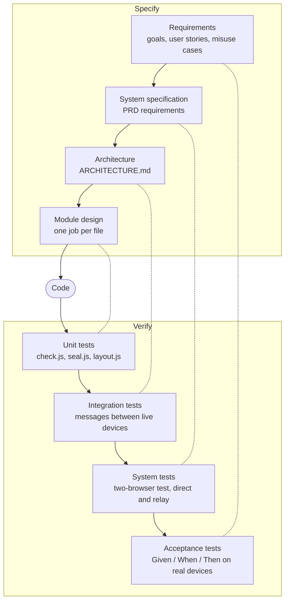

# Testing: universal sharing

How the product is tested. Requirement IDs are in the [PRD](PRD.md). Misuse cases are in the [threat model](THREAT-MODEL.md#misuse-cases). The design being tested is in [ARCHITECTURE.md](ARCHITECTURE.md).

## 1. Approach (V-model)
Each level of specification is paired with the level of testing that proves it. Development itself is iterative and tracked on the project board. The V-model is used to plan the tests.



## 2. Test plan
Which level of test proves each requirement. Results are recorded on each requirement's issue.

| Requirements | Level | Test |
|---|---|---|
| G1, N1 | Acceptance | A first-time user shares one photo from an iPhone to a laptop, timed from opening the link to "Tap to save" |
| G1, N1 | System | The two-browser test records time to ready and transfer time, direct and relay. The measured relay speed is written into the test output so the 15 s target can be checked against real numbers |
| N4 | Acceptance | Share a file using only the keyboard, then with VoiceOver |
| US1–US17 | Acceptance | Each Given / When / Then on real devices |
| Misuse cases | Acceptance, Integration | Each attack must fail. The threat model says which run automatically |
| C2–C9, C13 | System | Two-browser test, direct and relay (exists) |
| C14, F1, F5, F7–F10 | System | New two-browser cases (to write) |
| N2, Q2 | System | Two-browser test in Chromium and WebKit |
| Q1 | System | Two-browser test as a required GitHub check |
| C10, N3, S1.1–S1.6, S2, S7, S10 | Integration | The attack or malformed message is sent between live devices and must change nothing |
| S3 | Integration | Matching words. A swapped key makes them differ |
| C1, C11 | Unit | `tests/check.test.mjs` (exists) |
| S6 | Unit, System | `tests/strip.test.mjs`: iPhone- and Android-style JPEG fixtures lose GPS and camera details, stay upright and a JPEG without metadata is unchanged. The two-browser test sends one with and one without "Keep details" (exists) |
| S5, S12 | Unit | New fixtures for file types and links (to write) |
| `seal.js`, `layout.js` | Unit | Key derivation, sealing and layout solving (to write) |
| F2 | System | Progress and error messages appear during a transfer and a failed fingerprint check (to write) |
| F3 | Acceptance | Save a received photo to the camera roll on an iPhone and an Android phone (manual) |
| F4 | System | A file already held is marked and not requested again (to write) |
| F6 | System | 50 prints added at once never fully cover each other (to write) |
| S4 | Integration | A device the host hasn't accepted receives nothing (to write) |
| S9 | Integration, Acceptance | A blocked device's prints disappear. A stranger's thumbnail is blurred (to write) |
| S11 | Integration | A room's code stops working 30 minutes after the last device leaves (to write) |
| S13 | System | After Leave, no received file or thumbnail is left in memory (to write) |
| S14 | Unit | A thumbnail over 400 × 400 pixels is not decoded (to write) |
| S15 | Acceptance | The site loaded inside another site's frame refuses to run (manual) |
| S16 | System | The room code is gone from the address bar after joining (to write) |
| S8 | Integration | A client without a token from the site cannot join a room's channel (to write) |
| Q3 | Acceptance | The Qodo review standards list shows one fingerprint standard (manual) |
| S17 | Unit | HEIC, PNG, WebP and video fixtures with GPS arrive without it (to write) |
| L2 | Acceptance | A first-time user joins screens with only the on-screen guide (manual) |

## 3. Running the tests
```sh
npm run test:unit       # unit tests
npm run test:browsers   # two-browser test, direct then relay (needs internet)
npm test                # both
```
