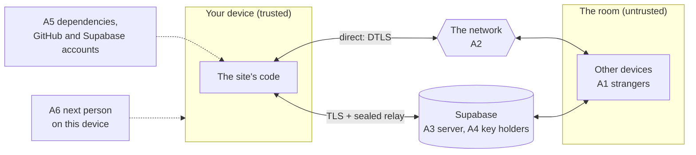

# Threat model: universal sharing

How someone might attack the product and what defends against it. It uses STRIDE and assumes every other device in a room may be hostile.

Each threat lists what defends against it **in place** (controls that exist in the code) and what is **planned** (requirement IDs from the PRD). A threat with nothing in place is open today. Progress on planned requirements is tracked on the project board.

**Keeping it current:** review this file whenever a new message type, data type or external service is added. Add new threats as new rows. When a planned requirement ships, move its ID from Planned to In place. A threat that no longer applies is marked "Withdrawn" rather than deleted.

## 1. Assets
| Asset | Why it matters |
|---|---|
| Shared content: photos, videos, files, links and text | Only the people it is shared with should see it |
| Hidden details: location, device model, filenames | A holiday photo can reveal where someone lives |
| Who is where: IP addresses, device names, who talks to whom | Reveals people and places without any content being shared |
| Availability of the room | One person should not be able to ruin it for everyone |
| Each person's device | Nothing received should run code on it or crash it |

## 2. Attackers
| ID | Attacker | Capability |
|---|---|---|
| A1 | A stranger with the room link | Join the room and send anything. The most likely attacker |
| A2 | Someone on the same network (café, hotel, ISP) | Observe or alter traffic |
| A3 | The room server (or anyone with access to it) | Sees every message passed between devices |
| A4 | Someone holding the Supabase key but in no room | Use the project without joining a room |
| A5 | Malicious code or a taken-over account: a dependency, the GitHub account or the Supabase account | Change what the site runs. Whoever controls the Supabase account can also see and change every message, the same as A3 |
| A6 | A later user of the same device (shared computer, lost phone) | Finds what was left behind, including room links in browser history |

## 3. Trust boundaries

Anything that crosses into a device from the room or the server is untrusted. This is the Stranger rule.

## 4. Threats (STRIDE)
**L** = likelihood and **I** = impact: **H**igh, **M**edium or **L**ow. IDs are permanent so issues and tests can refer to them.

### 4.1 Spoofing
| ID | Threat | Attack | By | L | I | In place | Planned |
|---|---|---|:---:|:---:|:---:|---|---|
| T-S1 | Impersonate another device | Send connection messages that claim to come from someone else | A1 | H | H | | S2 |
| T-S2 | Become the time keeper | Misreport when they joined | A1 | M | M | | S1.1 |
| T-S3 | Swap encryption keys | Replace each person's public key during setup | A3, A5 | L | H | | S3 |
| T-S4 | Imitate the site | Host a lookalike at a similar address | A5 | L | H | | OQ6 |
| T-S5 | Take over as time keeper when the host leaves | Claim the role during the hand-over | A1 | M | M | | OQ8 |
| T-S6 | Pass as someone else by name | Pick a name that looks like a friend's: different case, full-width letters, accents, a letter from another script, invisible characters or a text-direction override | A1 | H | M | Names are drawn on a canvas, so nothing runs (T-E1) | S19 (name key, `validName`), S2 (colour and icon from the key) |
| T-S7 | Join onto someone's screen uninvited, then receive their photos | Tap a matching join tab at the same moment as the real person. Or place a tile next to theirs in the mini-map. Once joined, photos dropped into the space would be fetched by themselves (F11) | A1 | M | H | | C15 (who joined and on which side, with Undo), C16 (the other device must accept), F11 (nothing is fetched by itself until the join has settled: accepted, or 10 s with no Undo; only prints dropped after that) |
| T-S8 | Pose as a device someone has seen before | Join with a remembered device's name from a different device | A1 | M | M | | S20 ("new device" for a known name on an unknown key) |

### 4.2 Tampering
| ID | Threat | Attack | By | L | I | In place | Planned |
|---|---|---|:---:|:---:|:---:|---|---|
| T-T1 | Alter a file in transit | Change bytes on the network or the relay | A2, A3 | L | H | DTLS on direct links. AES-GCM on the relay. SHA-256 on every file (C9, C11) | |
| T-T2 | Crash or confuse a device | Send malformed messages | A1 | H | M | A check for every message type (C10) | N3 tests every type |
| T-T3 | Replay old relayed messages | Resend a captured sealed message | A3 | L | M | | OQ2 |
| T-T4 | Move other people's prints | Send moves for prints they don't own | A1 | M | L | Moves are validated. Allowed by design | S9 blocking |
| T-T5 | Slip bad pieces into a spread file | Once pieces can come from any holder, send garbage pieces or claim to hold a file | A1 | M | M | Today pieces are only accepted from one device and the whole file is checked (C11) | R1 (a hash per piece), R2 (strikes) |

### 4.3 Repudiation
| ID | Threat | Attack | By | L | I | In place | Planned |
|---|---|---|:---:|:---:|:---:|---|---|
| T-R1 | Share something abusive and deny it | There are no accounts and names are chosen by each person | A1 | M | M | Accepted for privacy | S4, S9. S2 ties each print to one device's key and S20 lets people recognise a device they've seen before |

### 4.4 Information disclosure
| ID | Threat | Attack | By | L | I | In place | Planned |
|---|---|---|:---:|:---:|:---:|---|---|
| T-I1 | Read content on the network | Capture Wi-Fi traffic | A2 | M | H | DTLS direct, sealed relay and TLS to Supabase (C8, C9) | |
| T-I2 | Server reads relayed content | Read what passes through | A3, A5 | L | H | Sealed end to end (C9) | S3 |
| T-I3 | Download files not shared with them | Request a file by its ID | A1 | M | H | | S10 |
| T-I4 | See everyone's thumbnails | Join with the link and watch | A1 | H | M | | S4, S9 |
| T-I5 | Learn where a photo was taken | Read GPS and camera details | A1 | H | H | S6: JPEG metadata removed before sending unless the sender keeps it. Other files (HEIC, PNG, WebP, video) are sent with a warning. Checked on a real iPhone: the picker's JPEGs keep GPS. S6 removes it | S17 (other formats) |
| T-I6 | Learn someone's IP address | Read it from direct connection setup | A1 | H | L | | OQ1 |
| T-I7 | Return later with an old link | Use a room code after the room is over | A1 | M | M | | S11 |
| T-I8 | Find files left on a shared computer | Use the browser after someone leaves | A6 | M | M | Received files are only ever held in memory | S13 (Leave clears memory and the tab's stored keys). S18 keeps keys, never received files, on disk, and deletes them at the next start-up at the latest |
| T-I9 | Learn from filenames | Read names such as "passport-scan.pdf" before anything downloads | A1 | M | M | | OQ5 |
| T-I10 | Server learns who talks to whom | Observe setup messages, names and screen sizes | A3 | H | L | Accepted. Listed as "allowed in the clear" in AGENTS.md. No content or keys | |
| T-I11 | Room links leak | Codes in the address bar end up in browser history, screenshots and shared screens | A1, A6 | M | M | Codes are unguessable (C1) | S11, S16, S4 |
| T-I12 | Recognise someone across rooms | A remembered signing key is the same in every room, so other people's devices can tell it's the same person | A1 | M | L | | S20 is off by default, is the person's choice and has Forget |

### 4.5 Denial of service
| ID | Threat | Attack | By | L | I | In place | Planned |
|---|---|---|:---:|:---:|:---:|---|---|
| T-D1 | Flood the room with devices | Open many connections | A1 | M | M | | S7 |
| T-D2 | Exhaust the room's shared limits | Announce hundreds of prints or start many transfers | A1 | M | M | Room-wide limits | S1.2 |
| T-D3 | Make devices resend large files | Request the same file repeatedly | A1 | M | M | | S1.5 |
| T-D4 | Leave others waiting | Never send a key or stop mid-transfer | A1 | M | M | Transfers give up after a minute (C12). Sends give up after 10 s with no progress (S1.3) | |
| T-D5 | Stop someone joining screens | Send forged clock replies | A1 | L | M | | S1.4 |
| T-D6 | Exhaust the free quota | Use the key to send large numbers of messages | A4 | M | M | | S8 |
| T-D7 | Run a phone out of memory | Send several very large files at once | A1 | M | M | 200 MB per file (C14) | S1.2 |
| T-D8 | Image bomb | Send a small thumbnail with enormous dimensions that uses gigabytes of memory while it decodes | A1 | M | M | Full files are never decoded on arrival. A thumbnail is decoded only if its JPEG header says it is at most 400 × 400 and nothing follows its end marker, where a gain map could hide (S14). Otherwise the print shows a plain card | |
| T-D9 | The room stops working if the host's key is lost | The host's page reloads or closes. Shared links no longer match the time keeper. An attacker could also try to force this | — | M | H | | Host key kept between reloads (ARCHITECTURE.md Keys). A new link if it is lost |
| T-D10 | Push large files onto joined screens | Drop huge files into a joined space or share them with everyone. Every device then downloads them by itself and uses up its data and memory | A1 | M | M | | F11 and F12 only fetch by themselves from the joined group or a deliberate share and only up to 20 MB (OQ9) |

### 4.6 Elevation of privilege
| ID | Threat | Attack | By | L | I | In place | Planned |
|---|---|---|:---:|:---:|:---:|---|---|
| T-E1 | Run script through a name, link or text | Embed HTML or script | A1 | M | H | Names are drawn on a canvas. Nothing runs | S12 for links and text |
| T-E2 | Disguise an app as a photo | Rename an .exe or .apk to .jpg | A1 | M | H | | S5 |
| T-E3 | Exploit the image decoder | Send a crafted image | A1 | L | H | The browser sandbox | S5, S14, OQ4 |
| T-E4 | Change the site's code | Compromise a dependency or the GitHub or Supabase account | A5 | L | H | Libraries vendored and pinned in `web/vendor/`. Two-factor sign-in on GitHub and Supabase | |
| T-E5 | Clickjacking | Load the site invisibly inside another site and trick people into clicking | A5 | L | M | | S15. GitHub Pages cannot send security headers. A meta tag cannot stop framing |

## 5. Priorities
Threats rated High for both likelihood and impact are fixed first: T-S1 (S2) and T-I5 (S6). Both are Must in the PRD.

## Misuse cases
| ID | As an attacker, I want to… | Threats | Prevented by | Test |
|---|---|---|---|---|
| MUC1 | Join a room from a link seen on someone's screen and download their photos | T-I3, T-I4, T-I7, T-I11 | S4, S10, S11 | Automatic (to write): a third browser joins and requests a file |
| MUC2 | Push an explicit image onto everyone's screen | T-I4, T-R1 | S4, S9 | Manual (to write) on real devices |
| MUC3 | Read photos relayed through the server | T-I2, T-S3 | Deaf Relay rule, S3 | Automatic (to write): a swapped key changes the four words |
| MUC4 | Find out where the sharer lives from their photos | T-I5 | S6 | Automatic (exists): a JPEG with GPS arrives without it (`tests/strip.test.mjs` and the two-browser test) |
| MUC5 | Crash or freeze everyone's room | T-T2, T-D1–T-D5, T-D8 | Stranger and One Slow Phone rules, S1, S7, S14 | Automatic: malformed messages in the two-browser test (exists for 4 types). Floods and the rest (to write) |
| MUC6 | Get someone to open an app disguised as a photo | T-E2 | S5 | Automatic (to write): a renamed .exe is refused |
| MUC7 | Inject script through a shared link or text | T-E1 | S12 | Automatic (to write): a link containing script runs nothing |
| MUC8 | Trick someone into clicking inside a hidden frame | T-E5 | S15 | Manual (to write): load the site in a frame on another page |
| MUC9 | Pass as a friend by using their name | T-S6, T-S8 | S2, S19, S20 | Automatic (to write): "SAM", "Ｓａｍ", "Ѕam" (Cyrillic) and "Sam" with a zero-width space are refused while "Sam" is in the room |
| MUC10 | Join onto someone's screen without them wanting it and collect the group's photos | T-S7 | C15, C16, F11 | Automatic (to write): a third device's mini-map request isn't joined until it is accepted. Undo within 10 s splits a tab join and nothing was fetched by itself. Prints dropped before the join settled are never fetched by themselves |
